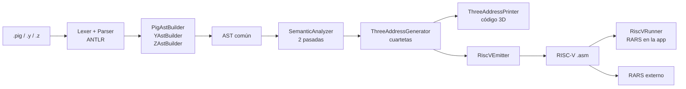
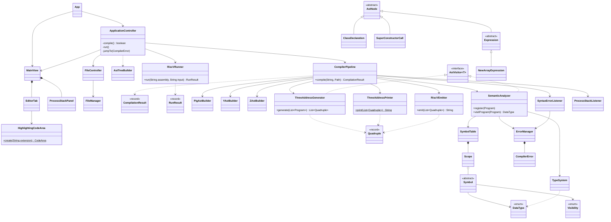

# st4ck-over-pig

Compilador de PigLatin (`.pig`), Y? (`.y`) y Zetariano (`.z`) a ensamblador RISC-V, con un editor propio en JavaFX
que también **ejecuta** ese ensamblador. Proyecto 2 de Organización de Lenguajes y Compiladores 2, Centro
Universitario de Occidente (CUNOC), segundo semestre 2026.

## Funcionalidades

- **Tres lenguajes de entrada** que producen el mismo AST:
  - PigLatin: el programa principal;
  - Y?: estructuras y funciones, con bloques por sangría;
  - Zetariano: clases al estilo Java.
- **Análisis léxico, sintáctico y semántico** con ANTLR4. Cada error muestra su tipo, el archivo, la línea, la
  columna, el lexema y cómo corregirlo.
- **Lo nuevo del P2.**
  - Zetariano: encapsulamiento (`public`, `protected`, `private` y default, que funciona como `private`), herencia,
    polimorfismo con `@Override` obligatorio y retorno covariante, `this` y `super`.
  - PigLatin: objetos con tipo explícito (`novus Profesor(..) : Persona`) y `null`.
- **Código de tres direcciones hecho a mano**, con sus cuartetas, y su traducción a RISC-V para RARS.
- **Ejecución dentro de la aplicación**: el botón "Ejecutar" corre el RISC-V en RARS 1.6, que viene embebido.
  También se puede descargar el `.asm` para comprobarlo en RARS por fuera.
- **Editor**:
  - el árbol de trabajo, para abrir, crear, guardar y descargar archivos y carpetas;
  - coloreado en tiempo real con el lexer del propio compilador, sin librerías de coloreado;
  - errores con salto al archivo y a la línea;
  - las pestañas de AST, tabla de símbolos, pila de procesos, cuartetas, código 3D, RISC-V y consola.

## Stack tecnológico

| Tecnología | Versión | Uso |
|---|---|---|
| Java | 21 (`maven.compiler.release`; probado con JDK 26.0.2.1) | lenguaje del compilador |
| ANTLR | 4.13.2 (`antlr4-maven-plugin` + `antlr4-runtime`) | lexers y parsers de los 3 lenguajes, patrón visitor |
| JavaFX | 21.0.9 (`javafx-controls`) | interfaz gráfica |
| RichTextFX | 0.11.3 | área de código con estilos por rango |
| RARS | 1.6 (licencia MIT), en `lib/` | simulador RISC-V: dentro de la aplicación y por fuera |
| Maven | 3.9 (probado con 3.9.11) | construcción; `maven-compiler-plugin` 3.8.0, `javafx-maven-plugin` 0.0.8 |

## Requisitos

- JDK 21 o superior.
- Maven 3.9 o superior.
- RARS no se instala: su jar viene en `lib/rars/rars/1.6/`, ordenado como un repositorio Maven del proyecto, porque
  no está en Maven Central.

## Levantar el proyecto

```
git clone https://github.com/DiegoMaldonado19/st4ck-over-pig.git
cd st4ck-over-pig
mvn clean javafx:run
```

Maven genera los parsers de ANTLR durante la compilación: no hay pasos manuales. `mvn clean compile` solo compila.
En NetBeans basta abrir la carpeta como proyecto Maven y ejecutar *Run*.

## Uso rápido

1. **Abrir carpeta**: elija `examples/p2/integrador` y haga doble clic en `main.pig`.
2. **Compilar**. La barra inferior muestra el resultado, y las pestañas de la derecha cada etapa: errores, AST,
   tabla de símbolos, pila de procesos, cuartetas, código 3D y RISC-V.
3. En la pestaña **Consola**, escriba en "Entrada" una línea por cada lectura (`Diego` y `6`) y pulse
   **Ejecutar**. La salida aparece en "Salida", cerrada por la línea `-- Programa terminado (codigo de salida 0) --`.
4. **Descargar .asm** guarda `main.asm` junto al `.pig`, listo para RARS.

## Comprobación externa en RARS

El mismo jar de `lib/` es RARS completo. Para abrir su interfaz:

```
java -jar lib/rars/rars/1.6/rars-1.6.jar
```

Ahí: *File → Open* `main.asm`, *Run → Assemble* (F3) y *Run → Go* (F5). Por consola, con su entrada, desde `cmd`,
Git Bash, Linux o macOS:

```
java -Dstdout.encoding=UTF-8 -jar lib/rars/rars/1.6/rars-1.6.jar nc me sm se1 ae2 main.asm < main.entrada.txt
```

PowerShell no admite `<` y parte en dos `-Dstdout.encoding=UTF-8`, así que ahí el mismo comando va dentro de
`cmd /c "..."`.

## Arquitectura

Los tres lenguajes producen **el mismo AST**, así el análisis semántico, las cuartetas y el RISC-V se escriben una
sola vez:



- **MVC**: `view` (JavaFX) no conoce ANTLR, `model` no conoce JavaFX y `controller` los une.
- `CompilerPipeline` resuelve los `import`, compila cada archivo con su front-end y corre el semántico en dos
  pasadas sobre todos los archivos: primero registra estructuras, clases y firmas, y después valida los cuerpos.
- Solo corta por errores léxicos: tras un error sintáctico sigue, para reportar también los semánticos.
- Solo un `.pig` sin errores genera cuartetas, código 3D y RISC-V.
- `RiscVRunner` ejecuta el RISC-V con la API de RARS (`rars.api.Program`) en un hilo aparte, con un tope de 11 millones
  de instrucciones.

| Paquete | Responsabilidad |
|---|---|
| `model` | `CompilerPipeline`: orquesta el pipeline y devuelve un `CompilationResult`; `RiscVRunner`: ejecuta el RISC-V |
| `model.analysis` | parse tree → AST (`PigAstBuilder`, `YAstBuilder`, `ZAstBuilder`) y validación (`SemanticAnalyzer`) |
| `model.ast` | AST común: `AstNode`, `AstVisitor<T>` y 40 nodos |
| `model.symbols`, `model.types` | tabla de símbolos, ámbitos, visibilidad y sobrecarga; tipos y compatibilidad |
| `model.codegen` | `ThreeAddressGenerator`, `ThreeAddressPrinter`, `RiscVEmitter`, `Quadruple` |
| `model.errors`, `model.stack` | errores léxicos, sintácticos y semánticos; pila de procesos del parser |
| `view`, `controller`, `util` | interfaz, eventos, archivos y carpetas |

<details>
<summary>Diagrama de clases (fuente Mermaid)</summary>



</details>

## Lenguajes

| Lenguaje | Extensión | Rol | Estilo |
|---|---|---|---|
| PigLatin | `.pig` | programa principal (`MAIOR>`), variables globales e imports | palabras en latín, bloques `{ } finis;` |
| Y? | `.y` | estructuras y funciones | tipo Python, bloques por sangría |
| Zetariano | `.z` | clases con encapsulamiento y herencia; los objetos viven en el heap | tipo Java |

## Ejemplos

Cada programa de `examples/` se compila desde su `.pig`. Junto a él están lo que se escribe en la consola,
`<programa>.entrada.txt` (solo si lee algo), y lo que imprime en RARS, `<programa>.salida.txt`. Los
`errores.pig` no compilan a propósito: su cabecera lista cada error que dan, con su archivo, línea y columna.

| Ejemplo | Lenguajes | Qué demuestra |
|---|---|---|
| `enunciado.pig` y `lib/Funciones.y` | PigLatin, Y? | Los fragmentos del enunciado de los dos lenguajes: declaraciones, arreglos, estructuras, funciones y ciclos. Lee de la consola. |
| `estructuras_y_funciones.y` | Y? | Las estructuras y funciones del enunciado de Y?, analizadas solas: los bloques por sangría. |
| `resistencia.pig` y `resistencia.y` | PigLatin, Y? | Funciones, recursividad, arreglos, estructuras, los tres ciclos, `interrumpe`/`perge` y `elegir`. Lee un número. |
| `matrices/` | PigLatin, Y? | Matrices con sus valores fila por fila, aplanadas en el heap. |
| `objetos/` | PigLatin, Zetariano | Los fragmentos del enunciado de Zetariano: expresiones, arreglos, matrices, objetos, `null`, `switch` con *fallthrough*, los ciclos, `readln` y recursividad. Lee un texto y un número. |
| `pila/` | los tres | La prueba de la auxiliar: una pila con `Nodo.z` y `Pila.z`, manejada desde un menú. |
| `pruebas-p1/00_hello_world/` | los tres | Hola mundo desde los tres lenguajes, y `Minimo.pig`. |
| `pruebas-p1/01_calculadora/` | PigLatin, Y? | Arreglos globales por referencia, un arreglo dentro de una estructura y recursividad. |
| `pruebas-p1/02_lista_doble/` | los tres | Una lista doblemente enlazada: referencias encadenadas, `null`, sobrecarga y `elegir :`. |
| `pruebas-p1/03_laberinto/` | los tres | Matrices como atributo con dimensiones variables, recursividad (*flood fill*) y `switch` con *fallthrough*. |
| `pruebas-p1/04_ahorcado/` | los tres | Arreglos `char[]` y `boolean[]` creados con `new` en el constructor, `elegir :` y el ternario. |
| `p2/operacion/` | PigLatin, Zetariano | El ejemplo de clase y del parcial (`docs/Ejemplo.txt`): el método recursivo `sumar`, paso a paso en el anexo del manual técnico. |
| `p2/encapsulamiento/` | PigLatin, Zetariano | `public`, `protected`, default y `private` en atributos, métodos y constructores, usados desde la misma clase, una clase hija, otra clase y el `.pig`; default solo dentro de su clase. `errores.pig`: los 27 usos prohibidos. |
| `p2/herencia/` | PigLatin, Zetariano | `Animal` y `Perro` del enunciado: lo heredado, `super(...)` y el `super()` implícito, el orden de un constructor, tres niveles de herencia y `super.describir()`. `errores.pig`: un ciclo, un padre que no existe, `super(...)` fuera de lugar o faltante, un `private` del padre y un `Animal` en una variable `Perro`. |
| `p2/polimorfismo/` | PigLatin, Zetariano | `Impresora`, `ImpresoraPDF` e `ImpresoraExcel` del enunciado en un arreglo de `Impresora`: cada `imprimir()` responde la versión de la clase del objeto, también desde `this.imprimir()`. `errores.pig`: las cuatro reglas de `@Override`. |
| `p2/piglatin-objetos/` | PigLatin, Zetariano | `novus Profesor(..) : Persona` y `null : Persona` del enunciado: los métodos se buscan en el tipo explícito y responden por la clase del objeto. `errores.pig`: un tipo explícito que no es la clase del `novus` ni una clase padre suya, y `null` con un tipo primitivo. |
| `p2/integrador/` | los tres | La misión de la resistencia: herencia en tres niveles, un arreglo de objetos, una matriz, recursividad en Y? y en Zetariano, y un arreglo que llega a Y? por referencia. Lee un nombre y un número. |
| `p2/banco/` | los tres | El banco de pruebas de la auxiliar, con `movimientos` declarado `protected` (aclaración del 24 de octubre): herencia, `@Override`, despacho sobre un arreglo de `Cuenta`, `null`, `double` con `int` y una estructura de Y? por referencia. |

## Manuales

- [Manual de usuario](docs/MANUAL_USUARIO.docx):
  - instalación y arranque;
  - la ventana, archivos y carpetas;
  - escribir en los tres lenguajes, compilar y leer los errores;
  - los resultados;
  - ejecutar dentro de la aplicación y comprobar en RARS;
  - ejemplos y problemas frecuentes.
- [Manual técnico](docs/MANUAL_TECNICO.docx):
  - tecnologías, instalación y arquitectura;
  - diagrama de clases;
  - palabras reservadas y símbolos, y gramáticas;
  - tabla de compatibilidad de tipos de los tres lenguajes;
  - análisis semántico;
  - código de tres direcciones, traducción a RISC-V y ejecución;
  - pruebas, mantenimiento, solución de problemas y limitaciones;
  - anexo: el ejercicio del parcial paso a paso, del fuente al RISC-V.

## Autor

Diego José Maldonado Monterroso · Carné 201931811 · CUNOC, 2026.
